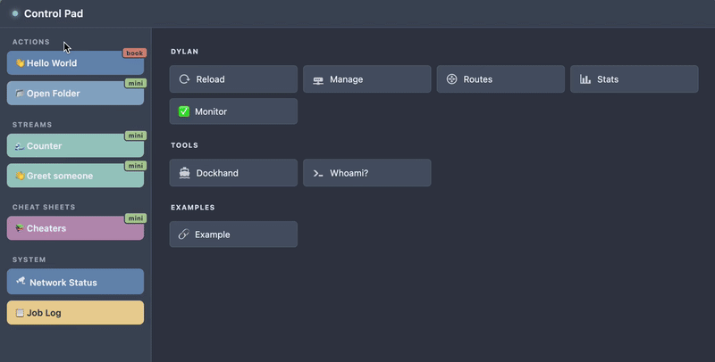
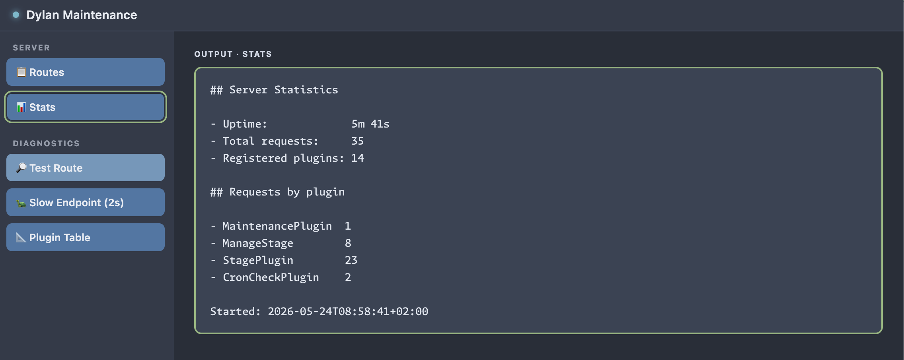
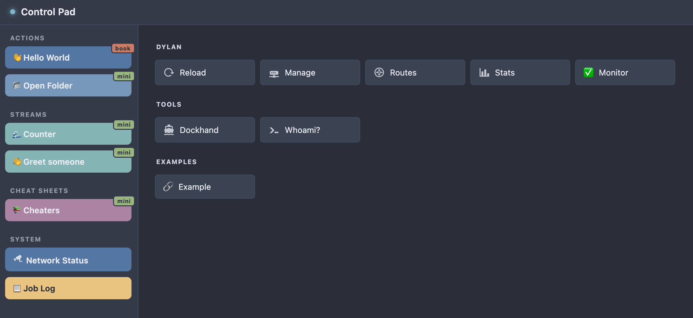

# dy.lan

[](https://github.com/rhsev/dy.lan/actions/workflows/test.yml)

A URL router for local networks with plugin-based automation

---
## What is Dylan?

Designed for local networks. Dylan matches the URL pattern and lets a plugin decide what happens: a redirect to an app-specific deep link, a search, a call to a script on a remote Mac via [Milan](https://github.com/rhsev/mi.lan). 

Or call an action in the web interface of your phone. The Dylan server calls a script on your Mac. The terminal output streams live back to the browser on your phone. No SSH client, no login prompt, no per-request authentication. 

Dylan turns local network URLs into workflows. 

---

## Three small examples

**Open a note in DEVONthink**  
`http://dy.lan/mini/dt/a1b2c3d4`: Dylan hands the 8-character alias to
the `dt` script on the Mac via the companion app Milan; it resolves the alias via AppleScript, DEVONthink opens the document. 

**Sync configs and install them**  
[grubber-twin](https://github.com/rhsev/grubber-twin) keeps Markdown-based configs in sync between two Macs.
`http://dy.lan/mini/install/foo` matches a pattern, Milan runs the install
script on the remote Mac without a login.

**Interactive scripts with input**  
`http://dy.lan/mini/stream/greet` opens a stream button in Stage. The
script emits a `MILAN_PROMPT` line; Stage renders it as a text input.
You type a name, `hello.rb` runs on the Mac, the notification pops up
there.



*GIF: counter stream from a Mac script, a workflow trigger, and a cheat sheet rendered as HTML*

---

## Why Dylan?

**Workflow Shortcuts**  
Turn URLs into actions with pattern-based routing. Search notes, trigger shortcuts, or open specific documents via memorable URLs.

**Extensible by Design**  
YAML configs for simple redirects. Ruby plugins for custom logic. Reusable libs for the heavy lifting (Milan client, HTTP-connection pool, static-asset serving with ETag). Add new workflows without touching the core. See [PLUGINS.md](PLUGINS.md) for the plugin guide.

**Made for the LAN only**  
Plain HTTP inside the LAN, without authentication or a cloud service. If you want access
from the road, put Tailscale or a similar zero-trust network in front. No third party gets remote-control rights to your Mac.

**Lean, modern Ruby**  
Ruby 4 with async/Fiber, ~3,000 lines of Ruby, ~35 MB RAM in steady state.
It needs no database, build step or framework. Stage, the template plugin for
the browser UI, is ~450 lines of JS.

---

## Quick Start

**Requirements:** Docker

```bash
git clone https://github.com/rhsev/dy.lan
cd dy.lan
docker compose up -d
```

Dashboard: `http://localhost:8080/dylan`

After the first build, code changes only need a restart: `git pull &&
docker restart dylan` (or a call to `/reload`) picks up everything. Only
`Gemfile` changes require a new image build.

> For host-based routing (`http://sync.lan`), give Dylan its own IP via a
> Docker macvlan network. See [DEPLOYMENT.md](DEPLOYMENT.md).


*Dylan maintenance dashboard: routes, stats and diagnostics in terminal style*

---

## Simple Use Cases

**Simple redirects (YAML)**
```yaml
# config/redirects.yaml
domains: ['dy.lan']   # optional: only for these hosts
redirects:
  - pattern: '^/g/(.+)$'
    target: 'https://google.com/search?q=${1}'

  - pattern: '^/gh/(.+)$'
    target: 'https://github.com/${1}'
```

**Host-based routing**
```yaml
# config/host-redirects.yaml
redirects:
  - pattern: 'sync\.lan'
    target:  'http://192.168.1.20:8384'
    type:    proxy      # URL stays; default is a 302 redirect
  - pattern: 'dt\.lan'
    target:  'http://192.168.1.20:8080'
```

**Ruby plugin**
```ruby
class NotesPlugin < Dylan::Plugin
  pattern %r{^/n/(.+)}

  def call(host, path, request)
    query = path.match(pattern)[1]
    Dylan::Response.redirect("shortcuts://run-shortcut?name=search_notes&input=#{query}")
  end
end
```

Access: `http://dy.lan/n/meeting` → Search Apple Notes for "meeting"

See [PLUGINS.md](PLUGINS.md) for the full plugin API.

---

## Stage, the front end

Stage is an automation UI. It's itself a Dylan plugin (`plugins/core/55-stage.rb`). You can start scripts on the server, trigger actions on the Mac, you get the live terminal stream of an action.


*Stage: link grid as landing page, action results stream into the right panel*

Each button is defined in YAML with a type:

| Type     | What it does |
|----------|-------------|
| `action` | HTTP call, result shown in the output panel |
| `stream` | SSE stream from Milan, live terminal output in the browser |
| `input`  | Text input → forwarded as a parameter |
| `notes`  | Cheat-sheet browser (fetched from Milan, split-view) |
| `jobs`   | Aggregated live job log across all Milan agents |
| `widget` | Passive state tile, pushed by scripts to a Milan agent |
| `panel`  | Switches the main area to a view: links, tiles, jobs, notes, frame, album |

```yaml
# config/stage.yaml
stage:
  title: "Control Pad"
  sheets_agent: "mini"

  sections:
    - title: "Actions"
      buttons:
        - id: greet
          label: "👋 Greet"
          type: stream
          url: "/mini/stream/greet"
```

Multi-instance via `StageBase`: the `/manage` dashboard is itself a Stage.
Private instances live in `plugins/custom/`. Self-hosted Monaspace font
(OFL), MDI icon support, mobile drawer layout, agent health badges,
multi-step workflows via `MILAN_PROMPT`.

---

## Companion: Milan

Dylan pairs with [mi.lan](https://github.com/rhsev/mi.lan), a lightweight script executor running on macOS or Linux. Dylan acts as the central router, Milan as the local executor.

```
http://mi.lan/mini/mail/abc123  →  Dylan  →  Milan (Mac)  →  script execution
```


Milan agents are declared in `config/milan.yaml`. Stage shows agent
health as live badges and aggregates job logs across all of them.

On start, an agent confirms its name at `/whoami?name=<agent>`
(`95-whoami.rb`): 200 when the caller's address is the agent's, 409 when the
claim comes from elsewhere, 404 for an unknown name. `whoami_also_from` in
`milan.yaml` lists extra caller addresses per agent, for a Mac that reaches
Dylan through another Mac's NAT. Requests to agents still go to their URL
under `agents`. Without a name, `/whoami` answers by caller address as
before, for older milan binaries.

`/probe` (`66-probe.rb`) asks every agent for `/ops-book` at the moment it is
called and lists the answers, one line per agent, plus freshness checks on
the NAS side. `/ops-book` is a script on the agent: its first line is
`book ok`, the following lines are facts for the report. An agent that does
not answer counts as absent, not as a failure; red is an agent that answers
with anything else.

`/monitor` (`65-monitor.rb`) serves the report that `scripts/monitor.sh`
writes from cron: a watch list of devices that should be up, and a sweep of
everything answering on the LAN. The plugin only displays the file.

Both answer with Markdown as `text/plain`, readable in a terminal and in
Stage's output panel.

---

## Project Structure

```
plugins/
├── core/      # routing, Stage, maintenance, Milan client wiring
├── extra/     # public examples & demos
└── custom/    # your private plugins (gitignored)

lib/
├── plugin.rb        # Plugin base class + DSL (config_file, abstract, timeout, …)
├── router.rb        # Request routing + circuit breaker
├── response.rb      # HTTP helpers (text / html / json / redirect / sse)
├── http_pool.rb     # Pooled Async::HTTP::Client
├── milan.rb         # Milan agent client (get, stream, health, SSE proxy)
├── ansi.rb          # ANSI → HTML for terminal output
└── static_assets.rb # Static file serving with ETag + mtime hot-reload
```

Plugins are loaded by scanning `plugins/` recursively and sorting by
basename, so the numeric prefix controls priority across all three folders.
First match wins.

---

## Technical Notes

**Runtime**  
Ruby 4 with [async](https://github.com/socketry/async) +
[async-http](https://github.com/socketry/async-http). `async-http` serves
requests directly, without Puma or Falcon, and there is no database. The
entire `Gemfile` is three lines: `async`, `async-http`, `protocol-http`. Everything else
is stdlib.

**Memory (~35 MB)**  
Ruby heap (~15 MB), about 3,000 lines of application code, and the cached
font file.

**Performance**  
A few milliseconds per request on the LAN. 2,000+ req/s on a Synology
DS224+, 15,000+ req/s on a Mac mini M4.

**Hot-reload**  
YAML configs are mtime-checked per request, throttled to 5 s intervals.
Static assets (CSS/JS/font) serve from memory after first load, validated
by ETag + mtime. Code changes need `/reload`: it ends the Ruby process and
Docker restarts the container within seconds.

**Streaming**  
SSE responses proxy live output from Milan agents straight to the browser.
The stream body closes cleanly when the client disconnects, also in the
middle of a stream, so nothing leaks.

---

## Features & Limits

**Does**
- Pattern-based URL routing in YAML or Ruby
- Host/domain-level routing
- Lightweight HTTP proxy for local services
- Remote script execution via Milan agents
- Live terminal streams in the browser (Stage)
- Plugin architecture for custom workflows
- Built-in dashboard (`/dylan`) with routes, stats, and route-tester
- Hot-reload for YAML configs (mtime-throttled), CSS/JS (ETag-validated)
- Circuit breaker (disables a failing plugin for 5 minutes; its paths answer 503)
- Reusable libraries: Milan client, HTTP pool, static-asset server
- ntfy push notifications

**Doesn't**
- No TLS (put Caddy in front if you need it)
- No authentication (only LAN)

---

## Project Status

Shared as-is. This project was built for use in personal automation workflows. The code is designed to be simple, transparent, and easy to extend with plugins.

**License:** MIT

---

## Credits

Built by Ralf Hülsmann ([GitHub](https://github.com/rhsev)), inspired by Brett Terpstra's Ruby tools and automation philosophy. Featured in Brett's [blog post](https://brettterpstra.com/2026/01/27/a-url-router-that-turns-your-local-network-into-a-workflow-engine/).


---

*Part of a family of plain-text tools. See the [profile page](https://github.com/rhsev) for an overview.*
